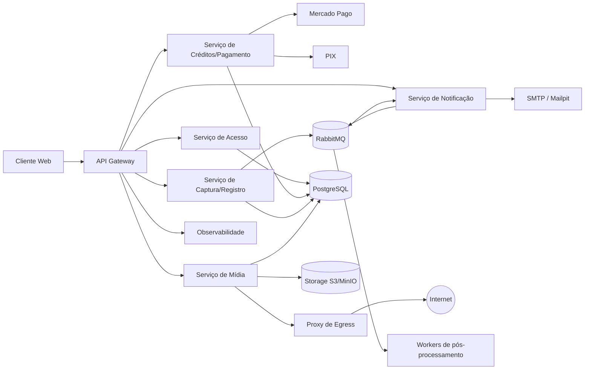

# Veridit — Arquitetura

Registra evidência de conteúdo web (captura de tela e vídeo de navegação) e opera a compra de créditos via Mercado Pago ou PIX.

## Sumário

1. [Características arquiteturais](#1-características-arquiteturais)
2. [Estilo arquitetural (ADR-001)](#2-estilo-arquitetural-adr-001)
3. [ADRs das 4 características principais](#3-adrs-das-4-características-principais)
4. [Componentes](#4-componentes)
5. [Diagrama de componentes](#5-diagrama-de-componentes)
6. [Especificação interna dos componentes críticos](#6-especificação-interna-dos-componentes-críticos)
7. [Estrutura de módulos](#7-estrutura-de-módulos)
8. [Táticas por característica](#8-táticas-por-característica)
9. [Índice de ADRs](#9-índice-de-adrs)
10. [Telas](#10-telas)

---

## 1. Características arquiteturais

Priorizadas a partir dos requisitos, das decisões D1/D2 e do atributo de qualidade declarado (Segurança), com ponderação pelo método de Richards & Ford.

| # | Característica | Peso | Justificativa |
|---|----------------|------|---------------|
| 1 | Integridade | 5 | Pagamento/créditos e evidência probatória exigem atomicidade e não-alteração. Inconsistência entre pagamento e crédito, ou alteração indetectável de evidência, compromete o produto. |
| 2 | Confiabilidade | 4 | A captura só vale se ocorrer enquanto o conteúdo está no ar. Falhas silenciosas em pagamento ou email geram inconsistências percebidas pelo usuário. |
| 3 | Segurança | 3 | Único atributo declarado nos requisitos. Trata dados sensíveis (CPF, OAB, senha, faturamento) e evidências com valor legal, sujeitos à LGPD. |
| 4 | Desempenho | 3 | Captura de tela/vídeo, relatório e ZIP são operações pesadas; executá-las de forma síncrona degradaria o momento crítico do registro. |
| 5 | Usabilidade | 2 | Secundária: a prioridade é a confiabilidade da evidência. |
| 6 | Extensibilidade | 2 | D1 (novos perfis), D2 (novos pacotes) e novos meios de pagamento devem evoluir sem redesenho. |
| 7 | Interoperabilidade | 2 | Integração com Mercado Pago, PIX e futuros provedores. |

> **Atenção:** a ADR-001 cita peso 2 para desempenho, enquanto esta tabela usa 3. Vale alinhar.

---

## 2. Estilo arquitetural (ADR-001)

**Decisão:** Arquitetura **Baseada em Serviços** como estilo global.

- Frontend web + API Gateway + serviços de domínio implantados separadamente.
- PostgreSQL compartilhado, com esquema por serviço.
- Mensageria assíncrona com transactional outbox.
- Microkernel apenas internamente, nos adaptadores de pagamento.
- Serviços: Acesso, Créditos/Pagamento, Captura/Registro, Mídia e Notificação.

### Matriz ponderada

| Estilo | Pontos |
|--------|--------|
| **Service-Based (escolhido)** | **54** |
| Microkernel | 52 |
| Monólito em camadas | 51 |
| Event-Driven | 42 |
| Space-Based | 40 |
| Microsserviços | 39 |

A margem sobre Microkernel e Camadas é pequena; a decisão é sensível aos pesos atribuídos.

### Alternativas rejeitadas

| Alternativa | Motivo |
|-------------|--------|
| Monólito em camadas | Tolerância a falhas mínima: sessões de navegador e geração de vídeo/ZIP competiriam com toda a aplicação. |
| Microkernel (global) | Fraco em tolerância a falhas e escalabilidade. Adotado só nos adaptadores de pagamento. |
| Microsserviços | Banco por serviço exigiria sagas entre créditos e registro; custo operacional alto. |
| Event-Driven (global) | Consistência eventual em todo o domínio e baixa testabilidade. Adotado só como mensageria interna. |
| Space-Based | Dados replicados em cache sem fonte única prejudicam a integridade. |

### Justificativa

- **Integridade:** banco compartilhado com transações ACID locais.
- **Confiabilidade:** serviços independentes e mensageria durável com outbox.
- **Segurança:** ponto único de entrada com autenticação centralizada.
- **Desempenho:** escala horizontal independente de sessões e workers.

### Consequências

- **Positivas:** transacionalidade simples; isolamento de carga e falhas; caminho de evolução para microsserviços; adaptadores de pagamento substituíveis.
- **Negativas:** esquema compartilhado acopla a evolução; PostgreSQL e gateway são pontos únicos de falha; exige CI/CD para múltiplos deployables e infraestrutura de mensageria.

---

## 3. ADRs das 4 características principais

| ADR | Característica | Decisão central |
|-----|----------------|-----------------|
| ADR-002 (rev1) | Integridade (5) | Livro-razão de créditos ACID no PostgreSQL; hash SHA-256 em streaming na origem; trilha de auditoria append-only com encadeamento de hashes; pagamento externo por webhook idempotente + reconciliação. |
| ADR-003 (rev1) | Confiabilidade (4) | Serviços com falha independente; transactional outbox; filas duráveis com retentativa exponencial e DLQ; consumers idempotentes; captura sem retentativa automática (segmentos preservados + estorno). |
| ADR-004 (rev1) | Segurança (3) | Auth centralizada no gateway com refresh token revogável; Argon2id; TLS; criptografia em repouso com índice cego; autorização por dono do recurso; proxy de egress contra SSRF. |
| ADR-005 (rev1) | Desempenho (3) | Sessões de captura em workers dedicados com streaming WebSocket adaptativo; pós-processamento assíncrono por fila; cache e paginação; controle de admissão visível ao usuário. |

---

## 4. Componentes

| Componente | Responsabilidade | Requisitos |
|------------|------------------|------------|
| Frontend Web | Interface React/TypeScript: cadastro, login, dashboard, registro, detalhes, relatório e ZIP. | REQ01–REQ15 |
| API Gateway | Entrada única; autenticação/autorização centralizada; roteamento; rate limiting; TLS. | REQ01–REQ04 |
| Serviço de Acesso | Cadastro, login, logout, recuperação de senha; emissão e validação de tokens; RBAC. | REQ01–REQ04; D1 |
| Serviço de Créditos/Pagamento | Pacotes, pedidos, livro-razão, adaptadores Mercado Pago/PIX, webhooks e reconciliação. | REQ05–REQ07; D2 |
| Serviço de Captura/Registro | Orquestra o registro: metadados, status, débito e estorno de crédito, sessão, listagem e detalhes. | REQ08–REQ13 |
| Serviço de Mídia | Sessões de navegador remoto (Playwright) e workers de pós-processamento: hash, relatório e ZIP. | REQ08–REQ11, REQ14, REQ15 |
| Serviço de Notificação | Emails transacionais via SMTP com Nodemailer. | REQ02, REQ07, REQ10, REQ11 |
| PostgreSQL | Fonte única de verdade; transações ACID; esquema por serviço; auditoria append-only. | Todos |
| RabbitMQ | Desacoplamento assíncrono; outbox transacional; retentativa exponencial; DLQ. | REQ07–REQ11, REQ14, REQ15 |
| Armazenamento de objetos (S3/MinIO) | Imagens, vídeos, HAR e ZIPs; versionamento, Object Lock e criptografia em repouso. | REQ08–REQ11, REQ15 |
| Proxy de Egress | Saída controlada do navegador de captura; bloqueio de IPs privados (SSRF). | REQ08; ADR-004 |
| Observabilidade | Logs estruturados, métricas Prometheus, painéis Grafana, alertas e health checks. | ADR-013 |
| Mailpit (dev) | Captura local de emails em desenvolvimento. | ADR-011 |

---

## 5. Diagrama de componentes



---

## 6. Especificação interna dos componentes críticos

### API Gateway
- **AuthFilter:** valida access token JWT (15 min) e injeta o contexto do usuário.
- **RefreshHandler:** refresh token opaco, rotacionado e revogável.
- **ResourceOwnerGuard:** verifica se o usuário é dono do recurso (contra IDOR).
- **Router:** encaminha para o serviço de domínio correto.
- **RateLimiter:** protege login e recuperação de senha contra tentativas em massa.
- **TLS terminator.**

### Serviço de Créditos/Pagamento
- **PackageSelector:** lista pacotes (básico, médio, premium).
- **PaymentAdapter:** interface substituível (microkernel) para Mercado Pago e PIX.
- **CreditLedger:** cada concessão, débito e estorno é um lançamento imutável; saldo derivado.
- **WebhookHandler:** valida assinatura, reconsulta status na API do provedor e processa de forma idempotente.
- **ReconciliationJob:** concilia pagamentos pendentes a cada 15 min.
- **AuditLogger:** registra cada ação na trilha append-only.

### Serviço de Captura/Registro
- **CaptureOrchestrator:** debita crédito e solicita sessão ao Serviço de Mídia.
- **MetadataWriter:** grava título, URL, data/hora início/fim, status, user-agent, viewport.
- **StatusUpdater:** atualiza o status e publica evento no outbox.
- **FailureHandler:** em falha de captura, marca "falhou", estorna crédito e notifica o usuário.
- **ListingService:** listagem e detalhes com cache e paginação.

### Serviço de Mídia
- **SessionManager:** abre Chromium por sessão em contexto isolado, com gravação de vídeo e HAR.
- **ScreencastBridge:** transmite a tela via CDP sobre WebSocket e aplica eventos do usuário.
- **HashCalculator:** SHA-256 em streaming durante o upload (ADR-002, ADR-008).
- **ObjectUploader:** envia para S3/MinIO com criptografia em repouso.
- **PostProcessor:** gera relatório (Playwright `page.pdf()`) e ZIP (`archiver`).
- **IdempotencyGuard:** evita duplicação por chave de operação.

### PostgreSQL
- **Schema:** esquemas separados por serviço (acesso, créditos, captura, mídia, notificação).
- **CreditLedger:** tabela de lançamentos imutáveis.
- **AuditTable:** append-only; o usuário da aplicação só tem `INSERT`; cada linha guarda o hash da anterior.
- **Outbox:** tabela pequena e transitória para publicação no RabbitMQ.
- **Indexes:** índices para desempenho de leitura (REQ12).

---

## 7. Estrutura de módulos

```text
veridit/
├── frontend/
│   ├── pages/
│   ├── components/
│   └── services/
├── gateway/
│   ├── auth/
│   ├── routing/
│   └── ratelimit/
├── acesso/
│   ├── cadastro/
│   ├── login/
│   └── token/
├── creditos/
│   ├── pacotes/
│   ├── pedidos/
│   ├── ledger/
│   ├── adapters/          (microkernel de pagamento)
│   └── reconciliation/
├── captura/
│   ├── orchestrator/
│   ├── metadata/
│   ├── listing/
│   └── status/
├── midia/
│   ├── session/           (Playwright)
│   ├── screencast/
│   ├── hash/
│   ├── upload/
│   └── postprocess/       (relatório, ZIP)
├── notificacao/
│   ├── email/
│   └── templates/
├── auditoria/
│   ├── trail/
│   └── verify/
├── observabilidade/
│   ├── logs/
│   ├── metrics/
│   └── alerts/
└── shared/
    ├── db/
    ├── queue/
    └── storage/
```

---

## 8. Táticas por característica

| Característica | Tática | Objetivo |
|----------------|--------|----------|
| Integridade | Livro-razão de créditos ACID | Atomicidade entre débito, estorno e mudança de status. |
| Integridade | Hash SHA-256 em streaming na origem | Provar que a evidência não foi alterada após a captura. |
| Integridade | Auditoria append-only com encadeamento de hashes | Tornar detectável qualquer remoção ou alteração na trilha. |
| Integridade | Webhook idempotente + reconciliação | Tratar a confirmação externa do pagamento sem sagas. |
| Integridade | Validação de campos | Impedir inconsistências na entrada. |
| Confiabilidade | Serviços com falha independente | Isolar falhas entre domínios. |
| Confiabilidade | Transactional outbox | Eliminar perda entre commit e publicação. |
| Confiabilidade | Filas duráveis + retentativa exponencial + DLQ | Garantir que operações críticas não se percam. |
| Confiabilidade | Consumers idempotentes | Evitar duplicação por reprocessamento. |
| Confiabilidade | Captura sem retentativa automática | Preservar a fidelidade da evidência; estorno em falha. |
| Confiabilidade | Health checks e alertas | Detectar e reagir a falhas. |
| Confiabilidade | Degradação graciosa | Preservar consistência mesmo com dependências externas instáveis. |
| Segurança | Autenticação/autorização no gateway | Reduzir superfície de ataque e unificar a política. |
| Segurança | Argon2id + refresh token revogável | Proteger credenciais e permitir logout efetivo. |
| Segurança | TLS obrigatório | Proteger dados em trânsito. |
| Segurança | Criptografia em repouso + índice cego | Proteger dados sensíveis (LGPD). |
| Segurança | Autorização por dono do recurso | Impedir IDOR. |
| Segurança | Proxy de egress com bloqueio de IPs privados | Neutralizar SSRF na captura. |
| Segurança | Trilha de acesso aos registros | Auditar quem acessou a evidência e quando. |
| Desempenho | Sessões de captura em workers dedicados | Isolar carga sensível à latência. |
| Desempenho | Streaming WebSocket adaptativo | Navegação fluida sob rede variável. |
| Desempenho | Pós-processamento assíncrono por fila | Tirar operações pesadas do caminho crítico. |
| Desempenho | Workers stateless com escala horizontal | Escalar apenas o componente sob pressão. |
| Desempenho | Cache e paginação | Otimizar leituras de listagem (REQ12). |
| Desempenho | Controle de admissão com fila visível | Proteger contra picos e comunicar a espera. |
| Desempenho | Feedback por status e email | Informar progresso sem bloquear. |

---

## 9. Índice de ADRs

| ADR | Título | Tema | Status |
|-----|--------|------|--------|
| ADR-001 (rev1) | Estilo Arquitetural do Veridit | Service-Based | Proposto |
| ADR-002 (rev1) | Priorizar Integridade | Integridade (5) | Proposto |
| ADR-003 (rev1) | Priorizar Confiabilidade | Confiabilidade (4) | Proposto |
| ADR-004 (rev1) | Priorizar Segurança | Segurança (3) | Proposto |
| ADR-005 (rev1) | Priorizar Desempenho | Desempenho (3) | Proposto |
| ADR-006 | Linguagem e Stack | TypeScript / Node / NestJS / React | Proposto |
| ADR-007 | Tecnologia de Captura | Playwright, navegador remoto interativo | Proposto |
| ADR-008 | Persistência e Armazenamento | PostgreSQL + S3/MinIO | Proposto |
| ADR-009 | Mensageria | RabbitMQ + Transactional Outbox | Proposto |
| ADR-010 | Integração de Pagamento | Microkernel + Webhook + Reconciliação | Proposto |
| ADR-011 | Envio de Emails Transacionais | SMTP / Nodemailer / Mailpit | Proposto |
| ADR-012 | Implantação e Ambiente | Docker Compose | Proposto |
| ADR-013 | Observabilidade | Logs JSON + Prometheus + Grafana | Proposto |

**Formato de cada ADR:** Contexto, Decisão, Alternativas Consideradas, Justificativa, Cenários de Qualidade, Consequências, Requisitos/restrições relacionados.

---

## 10. Telas

| Tela | Requisitos | Descrição |
|------|------------|-----------|
| T01 — Cadastro | REQ01 | Formulário com campos do Apêndice A (advogado/usuário comum). |
| T02 — Login | REQ03 | Email e senha; link para recuperação. |
| T03 — Recuperar Senha | REQ02 | Reset por email (token de uso único, 30 min). |
| T04 — Home/Dashboard | REQ12 | Lista de registros com status e paginação. |
| T05 — Compra de Créditos | REQ05 | Seleção de pacote (básico, médio, premium) e dados de faturamento. |
| T06 — Pagamento | REQ06 | Mercado Pago ou PIX; exibição de QR Code/número PIX. |
| T07 — Confirmação de Pagamento | REQ07 | Feedback e email de confirmação. |
| T08 — Iniciar Registro | REQ08 | Campo de URL do site e título do registro. |
| T09 — Acompanhamento do Registro | REQ09, REQ11 | Status em tempo real; progresso de captura/vídeo; fila de admissão se a capacidade esgotar. |
| T10 — Detalhes do Registro | REQ13 | Metadados, imagens, vídeos, hash, status. |
| T11 — Relatório | REQ14 | Relatório com campos do Apêndice A. |
| T12 — Download ZIP | REQ15 | Geração assíncrona e download do ZIP. |
| T13 — Perfil/Configurações | REQ01, D1 | Dados do usuário; evolução para empresas. |

**Fluxo principal:** T01 → T02 → T04 → T05 → T06 → T07 → T08 → T09 → T10 → T11/T12